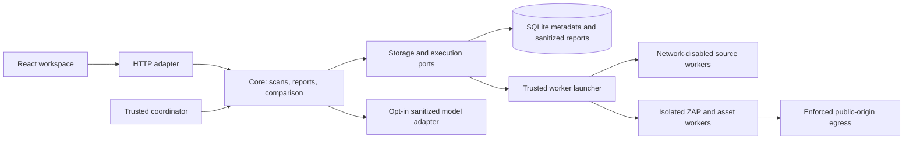

# Architecture Spine — AI Security Reviewer

## Design Paradigm

Hexagonal modular monolith: domain/core owns Scan state and report policy; HTTP, scanners, storage and model providers are adapters. A trusted coordinator dispatches bounded isolated workers. No uploaded application runs. [ASSUMPTION ARCH-A1] Local single-team deployment on a Linux container runtime, including a Docker Desktop/WSL2 runtime on Windows if available; actual availability is a build gate.



Arrows express dependency/call direction, not authorization for arbitrary tool access. The launcher may control the container runtime; API and scanner containers never receive its socket.

## Invariants & Rules

### AD-1 — Required independent intake [ADOPTED]

- **Binds:** FR-1–FR-9; intake and UI.
- **Prevents:** source-only scope or website checks masquerading as backend-source review.
- **Rule:** `codebase` and `repository` use Gitleaks/Semgrep; `website` uses ZAP baseline plus a bounded asset-secret pass. All three are required. Store mode and revision/observation per Scan. Preserve PRD A1–A5 as provisional scope; do not add private/history/active scanning implicitly.

### AD-2 — One state owner

- **Binds:** coordinator, storage and HTTP; FR-10, FR-16.
- **Prevents:** adapters mutating reports differently or duplicate scans on retries.
- **Rule:** core alone validates transitions and commits metadata/sanitized reports. SQLite persists queue and claims; one trusted coordinator claims one job at a time transactionally. Workers return bounded results and never access the database. Recovery marks abandoned jobs failed and runs cleanup; no automatic repeat scan.

### AD-3 — One external contract

- **Binds:** frontend, API, adapters; FR-11–FR-19.
- **Prevents:** incompatible evidence, status and comparison shapes.
- **Rule:** [API-CONTRACT.md](API-CONTRACT.md) owns the initial `v1` boundary. Typed source/web locations, machine status codes and coverage manifests are mandatory. Implement backend models/OpenAPI from it, generate frontend types and validate fixtures before parallel feature integration; afterward checked-in generated schema owns structural detail. Breaking changes require a new contract version and updated fixtures.

### AD-4 — Sanitized persistence boundary

- **Binds:** every adapter, storage, logs, UI and model; NFR-1, FR-11–FR-15.
- **Prevents:** leaking vendor secret fields or treating source/page instructions as authority.
- **Rule:** raw source and vendor output exist only in bounded per-job scratch; normalization/redaction occurs before database, logs, responses or model input. Raw stdout/stderr is never logged. Strip unknown vendor fields; render escaped text; sanitize URL credentials/query values and headers. Public IDs never derive from raw secrets. Sanitization failure fails the affected check closed.

### AD-5 — Fixed restricted source execution

- **Binds:** Gitleaks/Semgrep workers, intake; NFR-2–NFR-3.
- **Prevents:** uploaded rules/scripts controlling checks or reaching host resources.
- **Rule:** execute only allowlisted argument arrays with trusted pinned configs/rules; no shell interpolation, installs, builds, hooks or target execution. Source is read-only; scratch separate; non-root, capabilities dropped, no-new-privileges, network disabled, no host secrets/socket, profile resource limits. Uploaded allowlists/config/inline suppression cannot silently disable mandated rules. Record deliberate exclusions.

### AD-6 — Repository retrieval shares intake policy

- **Binds:** repository adapter; FR-2–FR-5.
- **Prevents:** Git options/hooks and repository downloads bypassing upload validation.
- **Rule:** accept only public `github.com` HTTPS owner/repository identifiers and optional ref; resolve a full commit through fixed provider endpoints, then retrieve that commit archive from an explicit GitHub download-host allowlist. Recheck destinations/redirects and all [SAFETY-PROFILE.md](SAFETY-PROFILE.md) archive/path limits. No `git clone`, submodule/LFS following or provider tokens in user URLs. Inventory unsupported content rather than executing it.

### AD-7 — Separate controlled website network

- **Binds:** ZAP, asset fetcher, egress; FR-4, FR-8, NFR-4.
- **Prevents:** SSRF, uncontrolled crawling or treating a clean ZAP report as complete secret coverage.
- **Rule:** ZAP and asset fetching have no direct outbound route; only a trusted enforcement path may connect to validated public addresses for the exact approved origin. Validate initial URL, redirects, actual DNS/connection destinations and byte/request/time budgets. Keep ZAP control private. Fetch bounded HTML-linked same-origin text assets without executing JavaScript; scan them with trusted Gitleaks config and map files back to asset URLs. Report runtime-loaded/unvisited assets as exclusions. If egress/budget enforcement cannot be demonstrated, URL functionality remains incomplete and public submissions remain disabled.

### AD-8 — Coverage-aware comparison

- **Binds:** comparison and UI; FR-16–FR-18.
- **Prevents:** missing findings being labeled repaired after failure or changed crawl scope.
- **Rule:** core compares only same-session same-mode lineage. Policies/tool/rule fingerprints must match for absence conclusions. Finding identity uses rule, normalized location and sanitized structural context, never line alone or raw-secret hash. Ambiguous duplicates are unverified. Website absence additionally requires comparable origin and that location actually reassessed. Cross-mode source clearing is forbidden. Use the four PRD comparison statuses; MVP never emits `verified_fixed`.

### AD-9 — Session ownership and deletion

- **Binds:** API/storage/worker lifecycle; FR-20–FR-21, NFR-5.
- **Prevents:** guessing IDs to read others' reports or resurrecting deleted data.
- **Rule:** use random server-side session tokens, HTTP-only SameSite cookie, same-origin API and CSRF protection on mutations. Every read/mutation checks ownership; unavailable/unauthorized resources share a nonrevealing 404. Idempotency keys are session-scoped with payload comparison. Delete first tombstones/hides a Scan, blocks worker commits, stops work and removes artifacts; cleanup failure is visible through its deletion operation, never reported as successful deletion.

### AD-10 — Model is a constrained explainer

- **Binds:** AI adapter and repair composer; FR-13–FR-15, FR-20.
- **Prevents:** model-created findings, commands or outages blocking reports.
- **Rule:** external sharing defaults off; explicit per-Submission choice is required. A bounded model call receives sanitized structured findings only. Reject unknown finding IDs, invented locations or invalid output; fall back to deterministic guidance. Core always composes the master prompt from accepted evidence and retains manual rotation actions. No model-controlled execution. The optional provider is configured server-side, never by uploaded text.

### AD-11 — One finite profile

- **Binds:** intake, workers, coordinator and API; NFR-3–NFR-7.
- **Prevents:** UI limits diverging from workers or unbounded queue/model/network work.
- **Rule:** `safety-v1` in SAFETY-PROFILE.md is the shared policy; expose user-relevant bounds as capabilities. Policy changes create a new policy fingerprint. Timeouts/over-limit checks are explicit incomplete outcomes; record coverage and never truncate a report silently into complete status.

### AD-12 — Deployment and operational gate

- **Binds:** runtime/configuration/CI and all epics.
- **Prevents:** a working UI being mistaken for a safe or complete scanner service.
- **Rule:** local same-origin application bound to loopback; isolated scanner networks and private storage outside the Git checkout. No unauthenticated public deployment. A production website may be assessed only within the authorized public-target policy. A known-safe fixture fallback must be labeled, and cannot satisfy missing required modes. Validate fixtures for all issue categories, rule licensing, immutable images/config hashes, runtime isolation, egress/cleanup and real rescans before declaring delivery. PRD/UX remain requirements; physical enforcement is tested during build.

## Consistency Conventions

| Concern | Convention |
| --- | --- |
| IDs / time | Random opaque IDs; UTC RFC3339 timestamps; no source/query/secret in IDs |
| State | Core-owned transitions in API-CONTRACT; findings and coverage committed atomically per tool result |
| Logs | Allowlisted job/tool/state/error-code fields; no raw body/URL query/stdout/source |
| Errors | Stable code plus safe user message and request ID; HTTP status carries transport meaning |
| Configuration | Server-owned policy/rules; environment holds model key; example files contain placeholders only |
| UI authority | Sally's DESIGN.md and EXPERIENCE.md; no divergent theme/schema |

## Stack

Cold-start candidate pins checked on 2026-10-23; installation and compatibility remain untested. Record immutable image/artifact checksums and full lockfiles during bootstrap. No floating `latest` is allowed at execution time.

| Name | Version |
| --- | --- |
| Node.js | 24.19.0 bootstrap runtime (Node 24 LTS); originally proposed 24.22.1 |
| React / react-dom | 19.3.1 |
| TypeScript | 5.9.3 verified with openapi-typescript 7.13.0; proposed 7.0.2 incompatible |
| Vite / react-ts starter | 8.3.5 |
| Python | 3.12.13 |
| FastAPI | 0.161.0 |
| SQLite | 3.53.1 locally observed; runtime version must be recorded |
| Gitleaks | 8.30.1 |
| Semgrep CE | 1.182.1 |
| OWASP ZAP | 2.17.0 |

Sources and fit checks: [React registry](https://registry.npmjs.org/react/latest), [TypeScript registry](https://registry.npmjs.org/typescript/latest), [Vite package](https://www.npmjs.com/package/vite?activeTab=versions), [Vite starter guide](https://vite.dev/guide/), [Node LTS](https://nodejs.org/en/download), [FastAPI](https://pypi.org/project/fastapi/), [Semgrep](https://pypi.org/project/semgrep/), [Gitleaks release](https://github.com/gitleaks/gitleaks/releases/tag/v8.30.1), [ZAP release](https://github.com/zaproxy/zaproxy/releases/tag/v2.17.0), [ZAP baseline](https://www.zaproxy.org/docs/docker/baseline-scan/), [container security](https://docs.docker.com/engine/security/). Python/SQLite versions were inspected locally. Container engine/provider and ancillary plugin pins are bootstrap outputs, not assumed installed. Freeze the starter's exact dependency set after a compatible build; changes to these candidate pins must update this seed and the version record.

## Structural Seed

```text
frontend/             UI and generated API types
backend/api/          HTTP/session boundary
backend/core/         state, contracts, report, compare, ports
backend/adapters/     storage, repository, scanners, model
workers/              trusted runners, egress/asset enforcement
rules/                reviewed fixed configuration and fixture-backed rules
fixtures/             controlled vulnerable/corrected/clean cases
tests/                contracts, safety and end-to-end acceptance
```

The trusted host launcher owns container orchestration. The API never gets Docker control. Browser and API use one origin; development proxy preserves session/CSRF behavior. SQLite WAL and private scratch live on local non-OneDrive runtime storage; repository sources contain no runtime data. Scheduled cleanup runs at startup and at least every minute. UI reconnects by Scan ID; no WebSocket or distributed queue is required.

## Capability → Architecture Map

| Capability / Area | Lives in | Governed by |
| --- | --- | --- |
| FR-1–FR-5 intake | HTTP + intake/repository adapters | AD-1, AD-3, AD-6, AD-11 |
| FR-6–FR-10 checks | launcher + source/web adapters | AD-4–AD-7, AD-11–AD-12 |
| FR-11–FR-15 evidence/prompt | normalization/core/model + UI | AD-3–AD-4, AD-10 |
| FR-16–FR-18 comparison | core + comparison UI | AD-2–AD-3, AD-8 |
| FR-19–FR-21 workspace/privacy | HTTP/session + UI + cleanup | AD-3, AD-9–AD-12 |
| NFR-1–NFR-7 | cross-cutting | AD-2–AD-12 |

## Deferred

Provider-specific optional model integration follows the defined port; deterministic fallback works without it. Private repositories/history, authenticated/active website scans, dependency scanning and combined-mode linkage remain PRD deferrals. Component library and fine UI implementation belong to frontend stories, constrained by UX. Exact schema implementation and generated types belong to bootstrap under API-CONTRACT, not independently invented adapters. Immutable image digests, starter plugin versions and measured feasibility are build evidence; their acceptance stories precede integration, with failure blocking delivery rather than relaxing invariants. Public hosting/multitenancy, managed queues and high availability are outside the local-demo boundary.

## Bootstrap evidence

Story 1.1 uses the [verified development setup](../../../../docs/DEVELOPMENT.md), uv/npm locks and generated `contracts/openapi.json`. Version metadata did not establish compiler/generator compatibility: the proposed TypeScript 7 candidate failed generation because its main export lacks `ts.factory`; TypeScript 5.9.3 passes with openapi-typescript 7.13.0. Health is a loopback bootstrap-only endpoint with no user data. Feature/session routes remain unimplemented. Scanner readiness and immutable image pins are separately measured in `contracts/scanner-readiness.json`; null versions/digests mean unverified, not ready.
